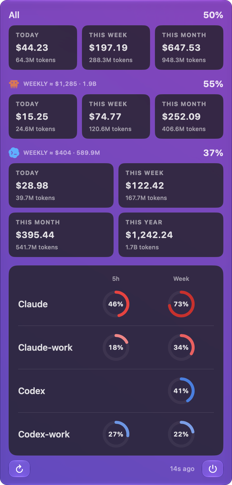

# Token Bar

A native macOS menu bar monitor for Claude Code and OpenAI Codex.

**macOS 14+ · Swift 5.10 · MIT**

<p align="center">
  
</p>

## At a glance

- 🟠 Claude quota windows and local token estimates
- 🔵 Codex quota windows and account activity
- 🟠🔵 One quota row per Claude and Codex account, with a ring per window
- 🟣 Kiro and Kiro CLI credits, with their bonus credits, as rows below Codex
- ⚙️ Settings to turn off any detected account's row
- ⚪ Capacity-weighted combined usage
- 🟠 Last-known values when a provider becomes stale
- 🔒 Local aggregation without raw transcript uploads
- 🧊 Liquid Glass on macOS 26 with a Material fallback
- 🔁 Weekly reset credits, and Claude's Fable resets, you can spend from the menu
- ⏱️ Automatic starts for idle Claude 5-hour windows
- 🧭 `cl` and `cdx` launchers that start each session on the login whose quota should go first

The dollar values show API-equivalent estimates, not subscription charges.
The screenshot uses local synthetic preview data.

## Use at your own risk

Token Bar is an unofficial tool for personal use and testing.
Anthropic and OpenAI do not make, endorse, or support it.

Some features rely on behavior the providers do not document, and some may conflict with their terms:

- Token Bar reads your Claude Code sign-in from the macOS Keychain and uses it to call Claude's undocumented usage endpoint, the one Claude Code's `/usage` reads.
  It spends Claude reset credits through the same undocumented protocol.
- It reads the sign-in token Kiro or the Kiro CLI saved and calls the usage-limits endpoint they call; it never renews that token.
- It starts idle Claude 5-hour windows by running the installed `claude` CLI, and each start counts against your usage limits.
- The `cl` and `cdx` launchers choose among several of your own logins by the quota each has left.
  Anthropic sets its limits for ordinary, individual use, and both providers forbid sharing a login with anyone else.

Anthropic and OpenAI can change or block these endpoints without notice, and can limit, suspend, or close an account that breaks their terms.
You run Token Bar at your own risk; the [MIT license](LICENSE) provides it as is, without warranty.
Read Anthropic's [Consumer Terms](https://www.anthropic.com/legal/consumer-terms) and [credential-use policy](https://code.claude.com/docs/en/legal-and-compliance#authentication-and-credential-use) and OpenAI's [Terms of Use](https://openai.com/policies/terms-of-use/) before you run it.

## Build from source

Install Xcode 26 or newer, then run:

```sh
./scripts/build-app.sh
open "build/Token Bar.app"
```

The build creates a Finder-openable app bundle.
Opening it shows the usage panel, including when the app is already running.
To keep a copy on the Desktop, copy `build/Token Bar.app` there in Finder and double-click it.

Sign in to Claude Code, Codex CLI, or Codex Desktop before refreshing Token Bar.
Extra accounts in `~/.claude-*` and `~/.codex-*` folders appear automatically; see [Architecture](docs/ARCHITECTURE.md#accounts).
To share one history across those accounts and start each session on the one whose quota should be used first, see [Shared accounts](docs/SHARED-ACCOUNTS.md).
Token Bar uses the installed Claude CLI to start idle 5-hour windows, which also renews an expired sign-in on an account with a 5-hour limit; see [Claude usage](docs/CLAUDE-USAGE.md).
Building and running the app does not require administrator access.
macOS may request access to the user's login Keychain for Claude usage data.

## How it works

Token Bar keeps provider quotas, local activity, and pricing as separate values.
One provider can fail without taking down the other or erasing its last successful reading.

🟠 Claude · 🔵 Codex · ⚪ available and All · 🟡 gauge center · 🟠 stale

Read the technical notes in [`docs/`](docs/README.md):

- [Accuracy and pricing](docs/PRICING.md)
- [Claude data boundaries](docs/CLAUDE-USAGE.md)
- [Weekly reset credits](docs/RESET-CREDITS.md)
- [Shared accounts](docs/SHARED-ACCOUNTS.md)
- [Architecture and performance](docs/ARCHITECTURE.md)
- [Local development](docs/DEVELOPMENT.md)
- [Design system](docs/DESIGN.md)
- [Subscription preview gallery](docs/SUBSCRIPTION-PREVIEWS.md)
- [Signed distribution](docs/DISTRIBUTION.md)

## Contributing

Issues and pull requests are welcome; for a number that looks wrong, include the displayed value, the expected value, and a source.
Leave out credentials, tokens, and private transcript content.

## License

[MIT](LICENSE)

Claude, Claude Code, Codex, and their marks belong to Anthropic and OpenAI.
Token Bar is not affiliated with Anthropic, OpenAI, Bandai Namco, or Sunrise.
