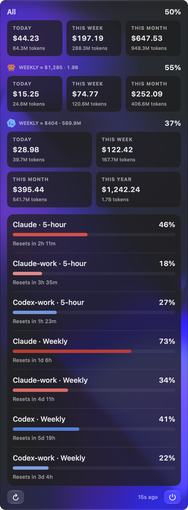
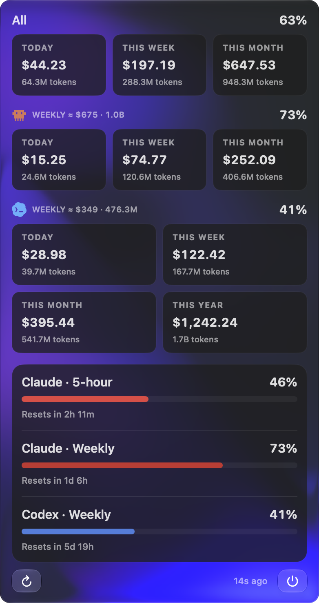
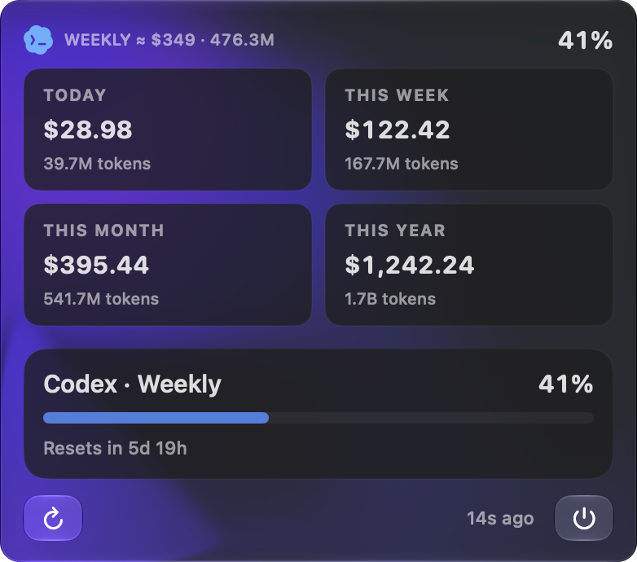
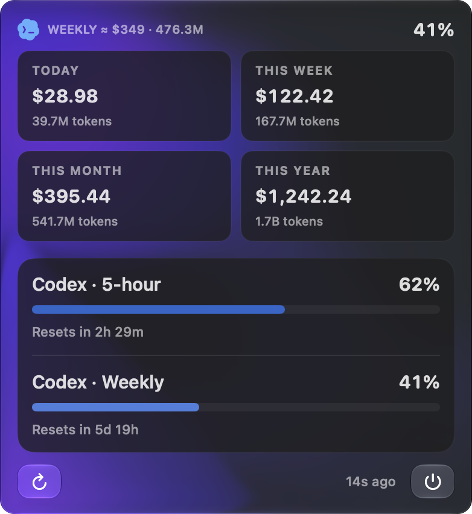
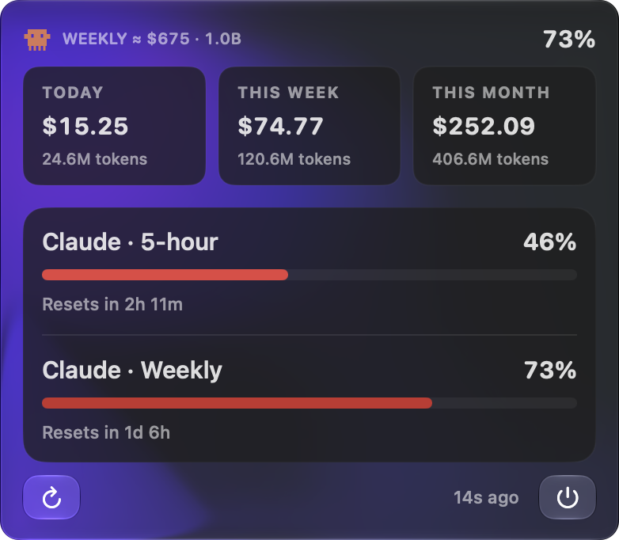

# Subscription preview gallery

Captured on October 11, 2026 on macOS 27.2 from the local app using `TOKENBAR_PREVIEW_STATE`.
These screenshots show synthetic usage data in the actual menu UI.
The dollar values represent fixture cost estimates, not subscription prices, bills, or guaranteed included value.

## Scope and sources

The five scenarios cover several accounts, Pro with Claude, Pro alone, Plus alone, and Claude alone.
They do not compare the $100, $200, and $500 Pro tiers.

OpenAI lists five-hour usage estimates for Plus, states that Pro plans currently have no five-hour limit, and notes that weekly limits may apply.
See [OpenAI pricing and usage documentation](https://learn.chatgpt.com/docs/pricing).
Do not infer the presence or absence of a quota window from the plan name alone.
Render the windows returned by the account API.

The Pro fixtures reproduce an observed `prolite` ($100 Pro) response: one seven-day window in the main `codex` bucket and no other buckets.
This observed shape does not establish a rule for all Pro accounts.
The Plus fixture represents a response with five-hour and seven-day main windows.

Anthropic documents five-hour session limits and weekly all-model limits for Claude Pro.
See [Claude Pro plan documentation](https://support.claude.com/en/articles/8325606-what-is-the-pro-plan).
The Claude fixture uses those two windows.

## Several accounts

Preview state: `multi-account`.
Two synthetic folders, `~/.claude-work` and `~/.codex-work`, sit beside the primary Claude and Pro accounts.
The activity cards cover the primary accounts, and the Codex header adds both accounts' weekly estimates.
The README uses this capture.



## Pro with Claude

Preview state: `both`.
The overview combines the two providers.
Claude's 5-hour row comes first, followed by the Claude and Codex Weekly rows.



## Pro alone

Preview state: `codex`.
The app omits the combined overview and Claude content when only Codex is connected.



## Plus alone

Preview state: `codex-plus`.
This fixture adds a 5-hour window to the main Codex Weekly window.



## Claude alone

Preview state: `claude`.
The app omits Codex content and the combined overview.



## Reproduce locally

Build once:

```sh
./scripts/build-app.sh
```

Quit any running Token Bar instance before launching a preview to avoid duplicate status items.
Run one command at a time, then quit that preview before starting the next:

```sh
TOKENBAR_PREVIEW_STATE=multi-account "build/Token Bar.app/Contents/MacOS/TokenBar"
TOKENBAR_PREVIEW_STATE=both "build/Token Bar.app/Contents/MacOS/TokenBar"
TOKENBAR_PREVIEW_STATE=codex "build/Token Bar.app/Contents/MacOS/TokenBar"
TOKENBAR_PREVIEW_STATE=codex-plus "build/Token Bar.app/Contents/MacOS/TokenBar"
TOKENBAR_PREVIEW_STATE=claude "build/Token Bar.app/Contents/MacOS/TokenBar"
```

Preview mode skips account refreshes, snapshot loading, and legacy preference migration.
The app opens the menu after the status item has settled into position.
Launch the app without `TOKENBAR_PREVIEW_STATE` to return to normal account data.
Dates and reset countdowns depend on capture time, so later screenshots need not match pixel for pixel.

The capture fell on a Sunday, so each launch added `-AppleLocale 'en_US@fw=mon'` to start that process's week on Monday; otherwise This Week would equal Today.
A window-only capture renders the translucent menu as flat gray, so each image captures the screen under the open menu while a blue-purple wallpaper window hides other windows.
A 24px rounded-corner mask then removes the menu's shadow.

## Verification

The release build and all 21 tests passed before this gallery was published.
We inspected all five menu windows: complete labels, the same spacing above the footer, and no unrelated provider content in single-provider scenarios.
This records one local macOS run, not coverage of every supported OS, display size, or subscription account.

Use `git status` and `git diff` for the current working-tree state; this gallery does not assert publication or deployment.
